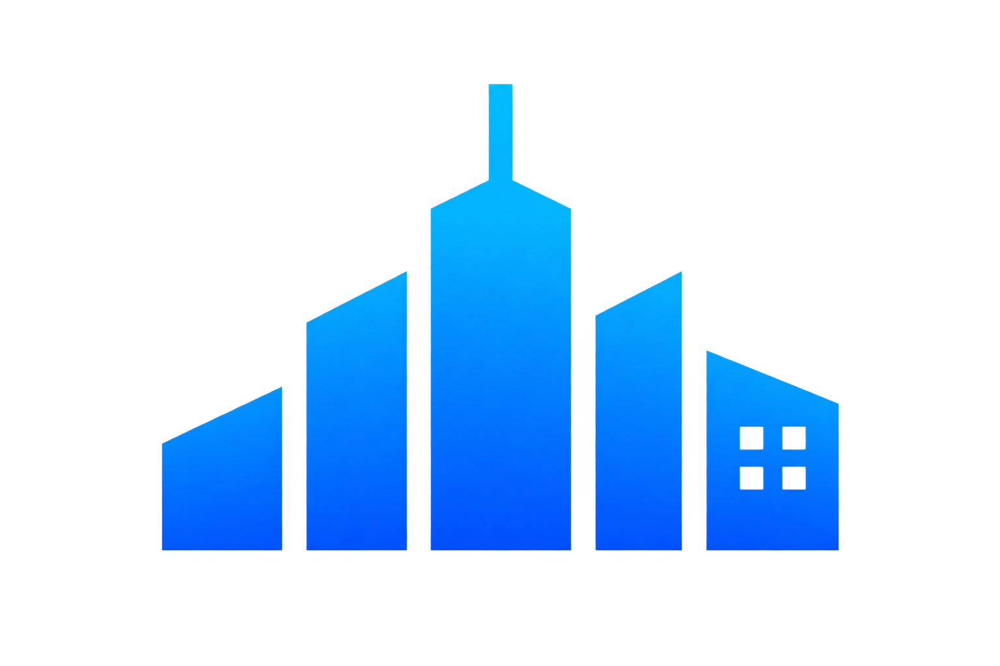
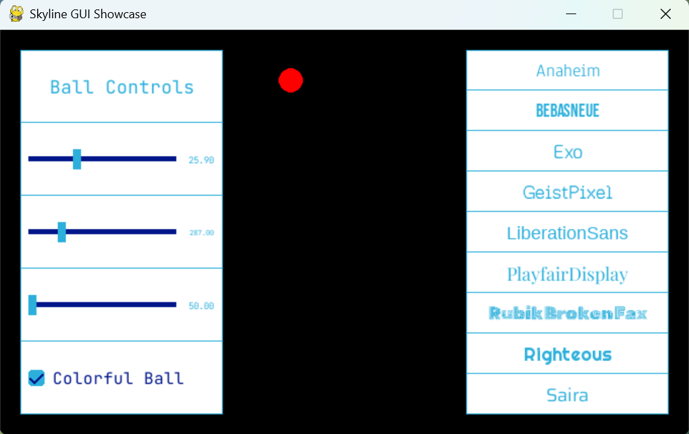
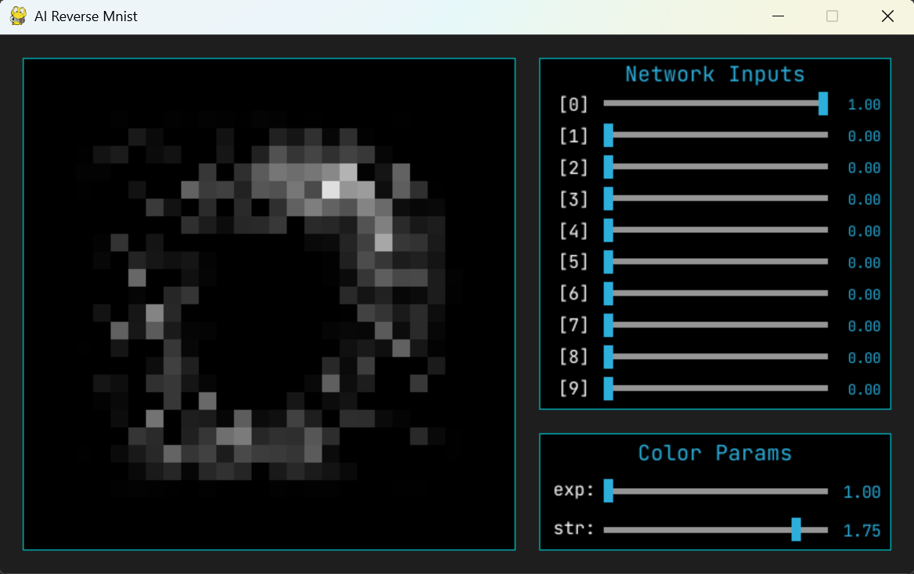

<p align="center">
  
</p>

<h1 align="center">Skyline</h1>

<p align="center">
  <strong>A simple pygame GUI library to create user interfaces as or alongside a project.</strong>
</p>

<p align="center">
  
  <a href="https://github.com/IAmDaanE/ai-reverse-mnist">
</p>

## About the Project

This library's design philosophy is to be simple to use and very customizable at the same time. It is meant to be used at the side alongside something like a simulation or visualization. 

It's a system of UI panels, the starting point is SkylinePanel(), you can have multiple of them in one window and then you add widgets to them with panel.add_widget(). The widgets like SkyCheckbox, SkySlider, SkyLabel will then stack vertically inside that panel. 

The biggest weakness of this system is that you can't have widgets horizontally alongside eachother.

## Project Structure

```text
skyline/
├── ui_components/      # all the classes for the actual widgets
    └── ...
├── core/               # code to help the ui components with displaying and working
    └── ...
├── assets/             # a lot of fonts and the checkmark images
    └── ... 
├── __init__.py         # the starting point of the package
├── skyline_panel.py    # the core SkylinePanel() class   
└── utils.py            # reusable helper functions
```

## Getting Started

### Installation

**Requires:** Python 3.10 - 3.14  
Run this command (preferably using a virtual environment):

```
pip install git+https://github.com/IAmDaanE/skyline-pygame.git@master
```

### Usage

Importing

```python
from skyline import SkylinePanel, SkySlider
```

Creating a panel

```python
panel = SkylinePanel(screen, x, y, width, height)
```
Adding a widget

```python
slider = SkySlider(min_value, max_value)
panel.add_widget(slider)
```

Interacting with the widgets

```python
panel.interact()
```

Displaying the panel

```python
screen.fill((0,0,0))
panel.draw()
pygame.display.update()
```

## License

This project is open-source and available under the MIT License.
